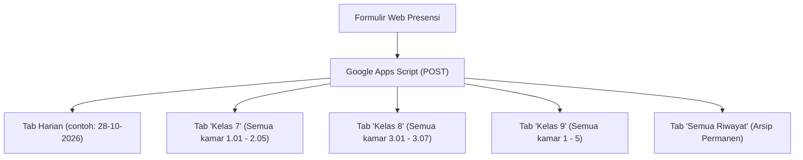

# Sistem Presensi Santri Asrama (Versi 5.0: Lintas Asrama & Pemisahan Tab Kelas)

Dokumentasi lengkap pembaruan sistem presensi asrama per kamar sesuai permintaan terbaru:
- **Penamaan Asrama:** 
  - **Kelas 9:** Asrama **IPS Lt 3** (Kamar 1 s.d. 5) -> format laporan: `IPS Lt 3 - Kamar [Nomor]`
  - **Kelas 8:** **Kelas 8** (Kamar 3.01 s.d. 3.07) -> format laporan: `Kamar [Nomor]` (tanpa tulisan IPS)
  - **Kelas 7:** **Kelas 7** (Kamar 1.01 s.d. 2.05) -> format laporan: `Kamar [Nomor]` (tanpa tulisan IPS)
- **Tampilan Bersih:** 
  - Tulisan `• Pak Mufti` di bar status telah dihapus.
  - Teks footer `Formulir internal asrama & UKS.` dan `Google Sheets Terhubung (Otomatis Pisah Tab Kelas)` telah dihapus.
- **Waktu Laporan:** Sesi **Pagi** dan **Malam**
- **Lintas Kamar/Asrama:** Bisa memilih santri dari banyak kamar sekaligus tanpa hilang saat berpindah kamar
- **Pemisahan Tab Google Sheets:** Otomatis memisahkan data ke tab **Kelas 7**, **Kelas 8**, **Kelas 9**, serta Tab Harian (`DD-MM-YYYY`) dan Tab Master (`Semua Riwayat`)
- **Tujuan WhatsApp:** Otomatis ditujukan ke nomor **08935603130** (`628935603130`)

---

## 1. Pemilihan Santri Lintas Kamar / Asrama (Bisa > 1 Asrama Sekaligus)

Saat pengurus asrama berkeliling memeriksa kamar:
1. Pilih **Kelas 7** > klik **1.01** > centang santri yang sakit.
2. Pindah ke **1.02** > centang santri yang alpa.
3. Pindah ke **Kelas 9** > klik **Kamar 2** > centang santri yang sakit.
4. **Semua santri yang sudah dipilih dari kamar mana saja tetap tersimpan di daftar (tidak hilang saat ganti kamar)**.
5. Pada Card 4 (Rincian Kondisi), setiap santri muncul dengan kartu masing-masing lengkap dengan label kamar asalnya (misal `Kelas 7 • 1.01`, `Kelas 9 • Kamar 2`).
6. Cukup klik tombol **Kirim Laporan Semua Asrama** satu kali untuk mengirimkan semua data santri tersebut ke Google Sheets dan WhatsApp!

---

## 2. Struktur Tab di Google Sheets (Versi 5.0)

Dengan skrip terbaru di [Code.gs](file:///c:/Users/Admin/Downloads/Sinau-Beta-test-main/absen-sakit/Code.gs), spreadsheet Anda otomatis tertata rapi dengan tab-tab berikut:



- **Tab `Kelas 7`:** Khusus merekap santri kamar 1.01 sampai 2.05.
- **Tab `Kelas 8`:** Khusus merekap santri kamar 3.01 sampai 3.07.
- **Tab `Kelas 9`:** Khusus merekap santri Kamar 1 sampai Kamar 5.
- **Tab Harian (`28-10-2026`):** Rekap seluruh santri hari ini dari semua kelas dan kamar.
- **Tab Master (`Semua Riwayat`):** Seluruh rekaman presensi asrama sepanjang masa.

Setiap tab memiliki kolom identitas lengkap:
`Waktu Kirim | Sesi (Pagi/Malam) | Kelas | Kamar | Nama Santri | Status Presensi | Sakit / Alasan | Rincian Gejala | Obat yang Diberikan | Mulai Sakit/Izin Sejak | Kondisi & Lokasi | Suhu Tubuh | Catatan Kamar | Petugas Pemeriksa`

---

## 3. Format Rekap Pesan WhatsApp ke 08935603130

Pesan WhatsApp otomatis dikelompokkan berdasarkan asrama/kamar tanpa emoji:

```text
LAPORAN PRESENSI ASRAMA - PAGI
----------------------------------------
Waktu Lapor: 28/10/2026, 14:40 WIB
Petugas Pemeriksa: Faris & Zahran
Total Santri Dilaporkan: 2 Anak (2 Kamar)
----------------------------------------
RINCIAN DATA SANTRI PER ASRAMA:

[KELAS 7 - 1.01]
1. Ahmad Mushtofa Kamal [SAKIT]
   - Keluhan: Demam / Badan Panas
   - Obat: Paracetamol 500mg
   - Mulai Sakit: Hari Ini (Pagi)
   - Lokasi: Istirahat di Kamar Asrama
   - Suhu: 37.9°C

[KELAS 9 - KAMAR 2]
2. Zahran Yasser Hamzah [ALPA]
   - Keterangan Alpa: Belum kembali ke kamar saat presensi
   - Lokasi: Tidak Berada di Kamar (Alpa)

----------------------------------------
Link Rekap Google Sheets:
https://docs.google.com/spreadsheets/d/144kdft1ccg2csUMS65NhTev9u7sl8ObiNJ75ybQRKF8/edit
```

---

## 4. Cara Update Google Apps Script

1. Buka file Google Sheets Anda > menu **Extensions (Ekstensi)** > **Apps Script**.
2. Hapus seluruh isi editor dengan **Ctrl+A** lalu **Delete**.
3. Buka file [Code.gs](file:///c:/Users/Admin/Downloads/Sinau-Beta-test-main/absen-sakit/Code.gs), salin semua kodenya (Ctrl+A lalu Ctrl+C), dan tempelkan ke editor Apps Script.
4. Klik **Save (Ctrl+S)**.
5. Klik **Deploy (Terapkan)** > **New deployment (Penerapan baru)** > pilih **Web app** > klik **Deploy** dan salin URL Web App berakhiran `/exec`.

---

## 5. Status Deployment Aktif
- **URL Google Apps Script Aktif:** `https://script.google.com/macros/s/AKfycbwgpoX0z59a0uGaJrloy8S2rUfCtLw-R79G9hVYoSySxf7tfHIy1cwNUKi4Qso460xwWA/exec`
- **Spreadsheet Terhubung:** [Google Sheets Presensi Asrama](https://docs.google.com/spreadsheets/d/144kdft1ccg2csUMS65NhTev9u7sl8ObiNJ75ybQRKF8/edit)
- **Status Integrasi:** Teruji berhasil (tab `Kelas 7`, `Kelas 8`, `Kelas 9`, `28-10-2026`, dan `Semua Riwayat` terisi otomatis).

---

## 6. Berkas Proyek & Repository GitHub
- **GitHub Repository:** [https://github.com/Zeinul899/presensi-santri-sakit](https://github.com/Zeinul899/presensi-santri-sakit)
- [absen-sakit.html](file:///c:/Users/Admin/Downloads/Sinau-Beta-test-main/absen-sakit/absen-sakit.html): Aplikasi web mandiri siap pakai (buka di browser HP / laptop).
- [standalone.html](file:///c:/Users/Admin/Downloads/Sinau-Beta-test-main/absen-sakit/standalone.html): Versi mandiri di folder `absen-sakit`.
- [Code.gs](file:///c:/Users/Admin/Downloads/Sinau-Beta-test-main/absen-sakit/Code.gs): Skrip Google Apps Script Versi 5.0.
- [App.jsx](file:///c:/Users/Admin/Downloads/Sinau-Beta-test-main/absen-sakit/src/App.jsx): Komponen React Vite.
